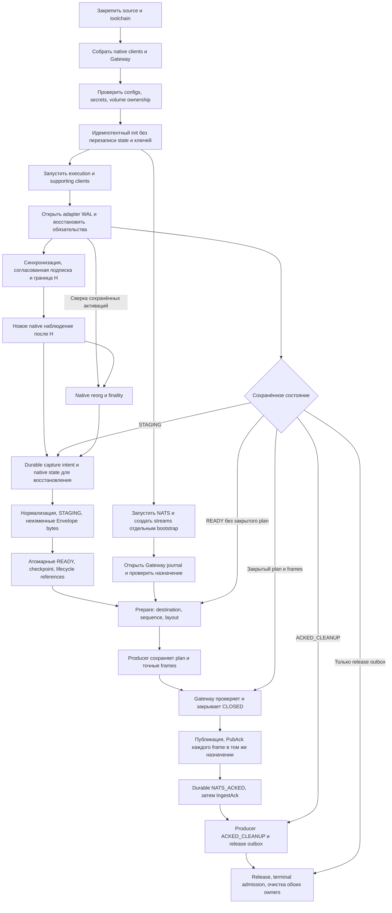

# Глубокий аудит flow и разработки — DOC-AUDIT-02

**Исторический аудит базы 8a88e5f.** Все его 41 находка впоследствии получили SPECIFIED в [реестре исправлений](DESIGN_REPAIR_STATUS.md). Указанные ниже открытые работы и next steps относятся к исходной проверке; текущая [итоговая сверка](FINAL_SPEC_REVIEW.md) учитывает последующие решения. SPECIFIED не означает runtime PASS; исходные доказательства сохранены без переписывания.

Дата: 2026-11-05. Основание: D55. Базовый commit: `8a88e5f`. Статус: аудит завершён; исправление находок не завершено. Выводы ниже — проектный анализ, не результаты запуска реализации.

**Итог: 41 самостоятельная находка — 29 P1 и 12 P2.** Native/семантика: 10; delivery: 13; bootstrap/эксплуатация: 12; порядок разработки: 6. Среди них есть подтверждённые дефекты схемы, конкретные контрпримеры и необходимые, но недописанные механизмы. Эти категории нельзя называть 41 воспроизведённым runtime-багом.

Ранние блокеры: NAT-01/04/07/08 — неверные/неполные контракты; NAT-02/03/05/09/10 и DLV-01/02 — источник данных и восстановление; DLV-06/07/08 и OPS-01 — fencing и исполнимый D54; DLV-10/11 — память и совместимость. Они определяют следующие документальные работы до консолидации ТЗ.

## Как читать результат

Текущий продукт: live Ethereum/BSC/Polygon → native capture → типизированная нормализация → независимые RocksDB WAL/Gateway → один NATS JetStream. D54 запрещает смену логического назначения до завершения pending. История, Base/Arbitrum, downstream, HA, performance thresholds, публичная поставка и обязательное вне-транзакционное balance расширение не возвращаются в scope.

Приоритет **P1** означает риск некорректных данных, невосстановимого состояния либо невыполнимого обещания; закрыть проектный вопрос до реализации затронутого механизма. **P2** — эксплуатационный, ресурсный или процессный пробел; закрыть до интеграционной приёмки. Приоритет здесь не означает обнаруженную аварию работающего продукта: кода пока нет.

Статусы доказательства: **противоречие** — документы требуют несовместимых действий; **контрпример** — конкретная последовательность не имеет корректного завершения в описанном автомате; **пробел** — необходимый механизм/инвариант не определён; **не проверено** — источник/совместимость ещё не подтверждены экспериментом. Предложенное исправление не считается новым принятым решением.

## Сквозной flow: обязательные границы

Диаграмма показывает требуемые логические границы. Порядок bootstrap/retry может перекрываться; NATS outage не должен блокировать сохранение новых данных при доступном диске. Узел durable intent ещё не обеспечен конкретным механизмом. Стрелка восстановления не означает replay всей пропущенной истории. ACK cleanup удаляет payload, но не необходимые lifecycle references.

Каждой стрелке нужны: входные identity, владелец, durable precondition, действие после timeout/crash, допустимый повтор, terminal/error result и future fixture. Наличие названий READY/CLOSED/ACKED без этих правил не завершает протокол.

## Native capture и семантика сообщений

### NAT-01 · P1 · AuthorizationSignature отбрасывает допустимое включение

**Источник:** [TRANSACTION_TYPE_REGISTRY](TRANSACTION_TYPE_REGISTRY.md):27; [MESSAGE_CONTRACT](MESSAGE_CONTRACT.md):21. **Статус:** подтверждённое противоречие native модели.

`Authorization.signature` использует TypedSignature с `y_parity=0|1`. Однако включённая EIP-7702 транзакция может содержать tuple с `y_parity=2`: native обработка пропускает невалидную authorization и продолжает транзакцию. Наша обязательная source-схема не сможет представить такой tuple и отвергнет всю запись.

**Предложение:** отдельный source-тип AuthorizationSignature с uint8; сохранять все tuple, порядок и дубликаты. Validity внешней транзакции и результат применения каждой authorization — разные понятия. Ограничение внешней typed signature не ослабляется. Отдельно проверить native authorization effects при root revert: нельзя выводить committed всех изменений только из receipt status.

**Проверка:** смешанные valid/invalid tuples, parity 2/255, неверные chain_id/nonce, повтор authority и root revert. E01/E02/E04. [EIP-7702](https://eips.ethereum.org/EIPS/eip-7702), [Geth принятого commit: tx_setcode.go](https://github.com/ethereum/go-ethereum/blob/9dffe6e976cbbb87a84c5fd395448f0950290def/core/types/tx_setcode.go) подтверждают uint8 source V и отдельную проверку authority. Исправление техническое; новый пользовательский выбор не нужен.

### NAT-02 · P1 · Асинхронный worker читает mutable данные hook

**Источник:** [ROCKSDB_DELIVERY_PROTOCOL](ROCKSDB_DELIVERY_PROTOCOL.md):13,27; MESSAGE_CONTRACT:59,63; v3 §10. **Статус:** пробел ownership с source-контрпримером.

OnEnter получает slice calldata из памяти VM. До чтения worker та же память может быть перезаписана returndata. Позднее чтение StateDB после следующей транзакции даёт before/after другой границы. Durable WAL и правильный digest закрепят уже неправильные данные.

**Предложение:** owned copies source bytes до возврата hook; transaction-boundary snapshot/journal state values; запрет отложенного чтения mutable VM/StateDB как источника прошлого события. Согласовать snapshot acceptance и backpressure с DLV-01/10.

**Проверка:** CALL с перекрытием input/return memory, две транзакции изменяют одинаковый account/storage, worker задержан. [Geth instructions.go](https://github.com/ethereum/go-ethereum/blob/9dffe6e976cbbb87a84c5fd395448f0950290def/core/vm/instructions.go) использует memory GetPtr и последующую запись результата; [evm.go](https://github.com/ethereum/go-ethereum/blob/9dffe6e976cbbb87a84c5fd395448f0950290def/core/vm/evm.go) передаёт input tracer. E01/E04.

### NAT-03 · P1 · Balance/code hooks не покрывают account existence

**Источник:** MESSAGE_CONTRACT:63; v3 §10; [ETHEREUM_BSC_CLIENTS](research/ETHEREUM_BSC_CLIENTS.md):28–36. **Статус:** source-backed пробел capture map.

Новый пустой account, CREATE с пустым code, создание/удаление в одной транзакции и rollback нельзя восстановить простой агрегацией balance/code/nonce callbacks. Balance может не измениться, а чтение existence после mutation уже потеряло исходный факт.

**Предложение:** отдельная карта creation/existence/deletion, before до первого изменения, after после native finalization; недостающий hook/native patch описать явно. Это source capture, не production completeness verifier.

**Проверка:** empty-code CREATE, CREATE→SELFDESTRUCT, новый получатель transfer, revert создания, существовавший пустой account. [Geth statedb_hooked.go](https://github.com/ethereum/go-ethereum/blob/9dffe6e976cbbb87a84c5fd395448f0950290def/core/state/statedb_hooked.go) делегирует CreateAccount/CreateContract без этих callbacks; balance hooks имеют собственные условия. E01/E04.

### NAT-04 · P1 · SELFDESTRUCT не помещается в обещанную модель действий

**Источник:** v3 §9:265–277; MESSAGE_CONTRACT:59–63. **Статус:** противоречие требований и логической схемы.

ТЗ требует действие с beneficiary/value и фактом удаления, но CallFrame.kind не содержит SELFDESTRUCT, а BalanceAction не имеет deletion result. При нулевом balance нельзя восстановить факт исполнения из transfer; итоговый AccountChange также не заменяет отдельное действие.

**Предложение:** typed execution action SELFDESTRUCT с cause, beneficiary, fork-dependent deletion result и отдельной monetary projection. Сохранять исполнение с нулевой суммой и отличать reverted effect.

**Проверка:** старый/созданный в этой tx contract, нулевой/ненулевой balance, beneficiary=self, outer revert. [EIP-6780](https://eips.ethereum.org/EIPS/eip-6780) и [Geth opSelfdestruct implementations](https://github.com/ethereum/go-ethereum/blob/9dffe6e976cbbb87a84c5fd395448f0950290def/core/vm/instructions.go). E02/E04; историческая выгрузка не добавляется.

### NAT-05 · P1 · Polygon block-alloc загрязняет обязательную StateSync tx

**Источник:** [ARBITRUM_POLYGON_CLIENTS](research/ARBITRUM_POLYGON_CLIENTS.md):60–61; TRANSACTION_TYPE_REGISTRY:97–108; MESSAGE_CONTRACT:49,63. **Статус:** подтверждённая source проблема атрибуции, ранее отмеченная частично.

Bor выполняет block-alloc upgrade внутри Finalize, обёрнутого tx hooks StateSyncTx. Code и balance upgrade могут попасть в diff обязательной 0x7f транзакции даже при выключенном optional outside-tx потоке. Фильтрация только code callback недостаточна.

**Предложение:** native scope barrier и baseline между block-alloc и самой StateSync; действия, не принадлежащие транзакции, не приписывать ей. Их отдельная публикация остаётся optional.

**Проверка:** block-alloc + StateSync, нулевой/ненулевой исходный balance, optional выключен. [Bor принятого commit: bor.go](https://github.com/0xPolygon/bor/blob/a16f123d9b4f41a552a3a98d93a0340430838576/consensus/bor/bor.go) отмечает проблему tx scope и выполняет SetCode/условный SetBalance. E01/E04.

### NAT-06 · P2 · Native receipt не равен полной execution projection

**Источник:** MESSAGE_CONTRACT:55; v3 §6/§9; ETHEREUM_BSC_CLIENTS:29,34. **Статус:** source-backed пробел field provenance.

При failed top-level CREATE native ContractAddress может быть вычисленным адресом попытки, а не успешно созданным контрактом. EffectiveGasPrice не заполняется в makeReceipt так, как требует нормализованный контракт. Простое копирование source struct даст ложный created_contract или нулевую комиссию; OnTxEnd.err также не заменяет EVM execution outcome.

**Предложение:** field-source/provenance таблица receipt, различение attempted/created/committed, effective gas price из native message/rules. Source receipt encoding сохраняется отдельно от производной projection.

**Проверка:** success/failed CREATE, constructor revert, EIP-1559 base/priority fee, failed included tx. [Geth state_processor.go](https://github.com/ethereum/go-ethereum/blob/9dffe6e976cbbb87a84c5fd395448f0950290def/core/state_processor.go) — makeReceipt. E01/E02/E04.

### NAT-07 · P1 · Reorg отменяет не только уже опубликованный Applied

**Источник:** v3:313,318,467; [STATE_OWNERSHIP](STATE_OWNERSHIP.md):13; ROCKSDB_DELIVERY_PROTOCOL:21,28; MESSAGE_CONTRACT:93. **Статус:** противоречие формулировок.

Applied уже READY, NATS offline, затем reorg; либо опубликована только первая multipart часть. Если «ранее опубликованный» трактуется как завершённый PubAck, Removed не создаётся. После reconnect старый Applied появится без отмены.

**Предложение:** lifecycle обязан учитывать все durable активации, Applied которых может быть доставлен, начиная с READY, независимо от знания факта внешней публикации. Removed-before-Applied уже разрешён. Ключ служебного наблюдения должен различать повторную активацию того же block hash/run, а не только номер/hash блока.

**Проверка:** reorg до Publish, после первой части, после потерянного PubAck, возврат той же ветки до завершения предыдущих batch. E03/E05.

### NAT-08 · P1 · StatusChanged может прийти раньше Applied

**Источник:** MESSAGE_CONTRACT:84–97,109–111. **Статус:** отсутствующий переход lifecycle.

Multipart Applied ещё собирается, а единственный finality StatusChanged уже доставлен. Таблица содержит ACTIVE+Status, но не ABSENT+Status. Одна реализация потеряет evidence, другая может ошибочно оживить уже Removed активацию.

**Предложение:** формальная семантика раннего evidence по ActivationRef, baseline revision в Applied, сравнение revisions, конфликт одинаковой revision и терминальность Removed. Правила относятся и к block, и к transaction; production consumer не создаётся.

**Проверка:** Status первым, Applied последним, несколько Status в обратном порядке, Removed между ними, конфликт одинаковой revision. E02 validator harness/E05.

### NAT-09 · P1 · Known/side-branch block может стать canonical без execution callback

**Источник:** C «Состояние и запуск»; v3 §5/§27; ETHEREUM_BSC_CLIENTS:67,80. **Статус:** неописанная граница восстановления и неоднозначность запрета replay.

Блок боковой ветки исполнен до H либо его временный trace уже отброшен. После начала live он становится canonical по known/skipped path, без нового исполнения. Есть canonical notification, но нет полного TransactionRecord. Одновременно §27 запрещает повторное live-исполнение только ради capture, а native research требует targeted replay известных блоков.

**Предложение:** определить сохранность speculative capture либо ограниченный native replay конкретного canonical/reorg наблюдения при отсутствии capture. Это не range backfill и не поиск downtime gaps. В исходном неизменяемом v2:764 уже допускается повторное исполнение ограниченных участков для сбоя/проверки/изменившейся ветки; поэтому вопрос не следует автоматически открывать как новый выбор истории. Нужно явно согласовать это исключение с v3 и native state availability.

**Проверка:** известная side branch становится canonical после H, возврат ветки, reorg ниже начальной H, недоступное требуемое state. До закрытия проверки нельзя обещать полный capture этого пути. E01/E05.

### NAT-10 · P1 · Lifecycle transition тоже требует durable intent и GC правил

**Источник:** ROCKSDB_DELIVERY_PROTOCOL:21,27–30; STATE_OWNERSHIP:13; прошлый аудит T03. **Статус:** конкретизация ранее открытого пробела.

Native reorg/finality произошло; adapter формирует несколько Removed/Status batch и падает между ними. Applied payload уже удалены. Без recoverable протокола перехода и сохранённых activation references нет доказанного способа завершить остаток отмены/finality. Identity уже durable событий должна сохраняться; непубликовавшееся observation до READY может получить новые event IDs по правилам восстановления попытки.

**Предложение:** durable transition intent/descriptor либо эквивалентная атомарная схема registry/revision+READY с идемпотентной restart reconciliation. Restart сопоставляет сохранённые активации с текущим authoritative native состоянием. Определить безопасный GC references отдельно от payload cleanup, в том числе после terminal Removed/finality. Не добавлять сканирование всех ненаблюдавшихся блоков.

**Проверка:** crash в каждом шаге много-блочного reorg, finality за downtime без нового head event, payload cleanup до restart, повтор native notification. E02/E03/E05.

Большой Envelope и несколько полных копий capture/serialization — общий DLV-10, повторно не считаются отдельной находкой. Первоначальная гипотеза о незаполненном receipt bloom на OnTxEnd не подтвердилась на выбранном Geth: этот случай исключён из дефектов. Transient storage не добавляется в обязательный transaction-boundary diff без отдельного требования.

## Delivery: контрпримеры и недописанные переходы

Источники сокращены: **R** — [ROCKSDB_DELIVERY_PROTOCOL](ROCKSDB_DELIVERY_PROTOCOL.md), **C** — [LIVE_CONFIG_SPEC](LIVE_CONFIG_SPEC.md), **M** — [MESSAGE_CONTRACT](MESSAGE_CONTRACT.md). Номера строк относятся к базовому commit аудита; названия разделов остаются смысловым ориентиром.

### DLV-01 · P1 · Наблюдение до durable intent

**Источник:** R:27–30,72; REC-T01. **Статус:** признанный ранее пробел, теперь включён в сквозной flow.

Callback получен, процесс падает до replay descriptor. После restart новая H+1 и запрет искать пропущенный диапазон не позволяют обнаружить конкретное событие. «Native replay» не определяет, что именно переисполнять и откуда взять исходное состояние.

**Предложение:** per-client таблица native acceptance → durable obligation → native commit → STAGING/READY. Сохранение intent, pin необходимого состояния и точка backpressure должны быть согласованы с native import, не менять consensus результат. Потеря до descriptor не объявляется допустимой молча.

**Проверка:** REC-T01 с crash между каждой парой шагов, изменением head и pruning; восстанавливается конкретное наблюдение, без сканирования разрыва. Закрыть проект до E01 capture; эксперимент — E01/E03/E05.

### DLV-02 · P1 · Повтор STAGING и дырки batch sequence

**Источник:** R:18–20,27–29,61. **Статус:** контрпример.

Повтор незакрытого capture получает новые event sequences. Не определено, остаётся ли batch_id прежним, как различаются attempts и куда деваются старые fragments. Новый batch_seq оставляет незавершённую дыру frontier; прежний без attempt generation допускает смешение references двух попыток.

**Предложение:** устойчивый batch_id с поколениями попытки либо доказуемый ABORTED-терминал для непубликовавшейся попытки. Атомарные замена manifest, освобождение старых keys и правило frontier обязательны. Очистка не удаляет последнюю восстановимую исходную информацию до durable замены либо сохранения достаточных replay prerequisites.

**Проверка:** STAGING-RERUN — несколько crash, reorg между attempts, поздний callback и pruning native state перед уборкой старых fragments; READY содержит только одну попытку, восстановимость сохраняется, старые keys очищаются, frontier продвигается. E03.

### DLV-03 · P2 · Незавершённые Prepare reservations

**Источник:** R:38–41,74. **Статус:** пробел.

Gateway сохранил reservation, ответ потерялся; producer повторил Prepare либо упал при записи plan. Не определены неизменность ответа, конфликт digest, смена лимита и очистка reservation, которая никогда не получит ACK.

**Предложение:** полный автомат PREPARED → CLOSED, idempotency key `(batch_id,manifest_digest)`, запрет двух действующих plans, owner-handshake для отмены только доказанно неопубликованной попытки. Не вводить TTL для CLOSED pending.

**Проверка:** REC-T03 с потерей каждого ответа, сменой лимита до commit, повторным Prepare и restart обеих сторон; нет конфликтующих plans и бесконечных orphan keys. E03.

### DLV-04 · P2 · Потерянный released frontier

**Источник:** R:42,61–63,75. **Статус:** контрпример.

Batch 1–100 released, producer удалил outbox. Gateway теряет store и получает pending 101. Новый непрерывный frontier не знает завершённый префикс 1–100; markers последующих releases могут накапливаться навсегда.

**Предложение:** восстановление release baseline из проверенного durable producer frontier либо иной явно описанный алгоритм нового Gateway epoch. Отсутствующие старые batch нельзя считать незавершёнными автоматически.

**Проверка:** REC-T04/07 после множества releases и потери Gateway: новые ACK/release завершаются, служебное состояние не растёт из-за недостижимого префикса. E03.

### DLV-05 · P2 · Publish после Release

**Источник:** R:41,62–63. **Статус:** контрпример.

Release удалил plan/frames, затем пришёл запоздалый Publish. Простая сериализация операций разрешает заново создать CLOSED, а producer уже не пришлёт новый Release. Допустимый повтор сообщения превращается в неубираемое служебное состояние.

**Предложение:** admission Prepare/Publish проверяет terminal released frontier/markers до создания keys; результат для завершённого batch определён и после восстановления Gateway baseline.

**Проверка:** задержанные Prepare/Publish до/после ReleaseAck и после Gateway recovery; terminal batch не воскресает. E03.

### DLV-06 · P1 · Fencing между admission и commit

**Источник:** R:22,63,83. **Статус:** пробел механизма заявленного инварианта.

Старый RPC проверил token и завис перед write. Новый session переключил owner; старый продолжил write или поздний PubAck callback изменил уже очищенный ackset. Проверки token только на входе недостаточно.

**Предложение:** session generation во всех мутациях, общий сериализованный порядок смены session и commit, правила поздних NATS callbacks. Drain completion выдаётся после barrier старых операций.

**Проверка:** REC-T12 с barriers перед write/PubAck/Release, пересекающимися reconnect и restart Gateway. E03; native concurrent lifecycle проверяется в E05.

### DLV-07 · P1 · Неоперабельный drain по D54

**Источник:** C:25–33,78,102,113. **Статус:** противоречие сценария и доступного интерфейса.

D54 требует прекратить новые наблюдения, продолжая delivery. SIGTERM закрывает native процесс и adapter state; обычный restart опять начинает H+1. Режим, который завершает STAGING/pending, но не принимает новые наблюдения, не описан.

**Предложение:** один исполнимый maintenance/drain lifecycle встроенного адаптера либо отдельный эксклюзивный способ дренирования его WAL. Определить lifecycle callbacks при quiesce, durable barrier, crash-resume без auto-resume capture и наблюдаемое через логи завершение. Собственный постоянный API/оркестратор и probe-спецификация не требуются.

**Проверка:** REC-T17 при непрерывном поступлении блоков, crash в drain и недоступном NATS. DRAINED невозможен до завершения обоих owners. E03/E06.

### DLV-08 · P1 · READY ещё не знает destination

**Источник:** R:28,38–42,56; C:76–78. **Статус:** контрпример принятому D54.

Producer сохранил READY при недоступном Gateway; Prepare не было. Gateway потерял store и сменил target. В producer нет прежнего destination, а его YAML знает только Gateway endpoint. Проверка сохранённого plan не обнаружит перенаправление этого pending.

**Предложение:** durable destination/configuration epoch до появления обязательств либо протокол первоначальной привязки pre-plan pending с доказательством отсутствия перенастройки. Развести первый bootstrap и восстановление потерянного store. При потере evidence — явная блокировка, не автоматический новый маршрут.

**Проверка:** REC-T17-PREPLAN: READY без Prepare, потеря Gateway, иной target; данные остаются в прежнем обязательстве. Отдельный fixture первого запуска. E03.

### DLV-09 · P2 · Не закреплены headers и publication request

**Источник:** R:39–44; M:105–107,113. **Статус:** пробел.

2 MiB включают NATS headers, но durable immutable bytes преимущественно описывают TransportFrame. Новая версия Gateway может изменить headers и сделать прежний frame непубликуемым или изменить publish semantics. Точное кодирование NATS message ID не закреплено.

**Предложение:** закрытый контракт headers, их связь с plan и размером, отдельные определения Envelope digest и публикационного запроса. Явно указать, какие transport metadata разрешено менять без изменения logical публикации.

**Проверка:** pending прежней версии на границе 2 MiB, новый Gateway, повтор после store loss; ID/назначение и согласованный размер сохранены. E02/E03.

### DLV-10 · P1 · Multipart не доказывает bounded RAM

**Источник:** R:13,27–28,38–41; C «Размер сообщения D52»; v3 §15/§27. **Статус:** пробел архитектуры.

Manifest/Prepare/plan содержат целый блок; отдельный Envelope содержит calls/code/storage. Полная сериализация или проверка call tree до разбиения может потребовать память пропорционально записи. Ограниченные frames не ограничивают управляющие RPC, validator и atomic batch.

**Предложение:** bounded chunks для manifest/plan/WriteBatch, spooled сериализация и валидация, явные лимиты управляющих сообщений и способ нелокальных проверок. Это не разрешение усечения или произвольного отказа от поддержанной транзакции.

**Проверка:** MEM-01: один большой record, блок с множеством малых records, медленный получатель и crash mid-manifest. Полные bytes восстанавливаются при ограниченном рабочем множестве. Архитектурная проверка, не performance benchmark. E02/E03.

### DLV-11 · P1 · Upgrade/replay/rollback несовместимых версий

**Источник:** C:100–101; R:40–44,50; M:21,105. **Статус:** пробел.

Новая сборка отвергает старую schema/build identity, но pending bytes нельзя переписывать, WAL нельзя переинициализировать. Не определено, чем завершить доставку после обновления и допустим ли rollback, особенно для незакрытого native STAGING.

**Предложение:** матрица store/plan/schema/native-profile versions для read/replay/new-write; preflight до мутаций; старый decoder либо обязательный drain перед несовместимым обновлением. READY replay отделить от STAGING, которому нужен прежний native execution context.

**Проверка:** UPG-01: частичный plan/ACK старой версии, upgrade и rollback клиента/Gateway; bytes неизменны, путь recovery определён. E01/E02/E03/E06.

### DLV-12 · P2 · Постоянно ошибочный batch

**Источник:** R:30,50,61; C:111; STATE_OWNERSHIP «Проверяемое поведение». **Статус:** пробел.

Schema/digest повреждённых immutable bytes не исправляется сменой настройки. Такой batch удерживает frontier и drain; продолжение следующих batch может бесконечно накапливать markers. ERROR не определяет дальнейшее состояние.

**Предложение:** классы transient/config/source-data/corruption, blocked state, область остановки и диагностируемый recovery. Bytes любого immutable события запрещено менять под тем же ID, даже до публикации. Пересоздание допустимой непубликовавшейся попытки требует новых event IDs, доказанного отсутствия публикации прежней попытки и правил DLV-02/03. Silent skip не разрешён.

**Проверка:** POISON-01: один invalid batch среди успешных, restart, drain, исправленная сборка; нет быстрого бесконечного retry, ложного успеха или потери pending. E03/E06.

### DLV-13 · P2 · Cleanup тоже требует свободного диска

**Источник:** R:9,60–66,82; DELIVERY_RECOVERY «Сценарии». **Статус:** незавершённый recovery путь.

После PubAck нужно записать ACKED marker/tombstones, но на полном диске места для них нет. Логическое удаление payload не гарантирует немедленного освобождения SST. Restart не устраняет ENOSPC.

**Предложение:** приоритет завершения/cleanup перед новым capture, безопасное расширение/освобождение места вне RocksDB, запрет ручного удаления SST/WAL и repair с потерей pending. Возможный служебный резерв — отдельный технический механизм, не квота/TTL pending.

**Проверка:** REC-T11-ENOSPC перед ACK marker, внутри cleanup и compaction; после добавления места recovery продолжается. E03/E06.

## Bootstrap, конфигурация и эксплуатация

Drain как режим — DLV-07; версия WAL/replay/rollback — DLV-11. Ниже они повторно не считаются отдельными находками.

### OPS-01 · P1 · Cutover двух owners не имеет durable границы

**Источник:** C:76–78; R:54–63. **Статус:** пробел.

Gateway уже получил новую конфигурацию, producer ещё старую; либо payload пуст, но release_outbox не завершён. Между проверкой пустоты и сменой конфигов может появиться старая операция. D54 требует общего факта завершения, но он не определён.

**Предложение:** cutover generation/barrier, состав учитываемых STAGING/reservations/ACKED_CLEANUP/release состояний, порядок изменения конфигураций и отказ при несовпадении поколений. Старое назначение сохраняется до доказанного завершения; механизм связан с DLV-06/07/08.

**Проверка:** crash между каждой записью/перезапуском, последний ReleaseAck потерян, один owner недоступен, старая session возвращается. Ни один случай не смешивает назначения. E03/E06.

### OPS-02 · P1 · Частично выполненный первый init

**Источник:** [NODE_DEPLOYMENT_SPEC](NODE_DEPLOYMENT_SPEC.md):122–126. **Статус:** пробел.

Init создал ключ и часть config/genesis, затем упал. Следующий запуск видит непустой каталог; нет правила отличить готовое состояние от частичного, не перегенерировать ключ и не стартовать с недостающими файлами.

**Предложение:** per-client init manifest, network identity, атомарное создание отдельных файлов, завершённый marker после валидации; повтор завершает безопасные недостающие шаги или явно останавливается. Отсутствующий config не даёт права перезаписать существующий key.

**Проверка:** crash после каждого файла, существующий ключ до первого init, неверный genesis и datadir другой сети. E06, дизайн до P0.2.

### OPS-03 · P1 · Замена native config может не примениться либо затронуть state

**Источник:** NODE_DEPLOYMENT_SPEC:89,95,122–126; C:90–100. **Статус:** пробел.

Новый `/config` существует, но клиент читает старую рабочую копию под `/data/node`; либо copy-all обновляет config вместе с ключом. Принцип D51 правильный, алгоритм применения поколения config отсутствует.

**Предложение:** таблица `source → effective path → owner → update policy`, precedence native args/config, валидация до запуска, применение цельного поколения без перезаписи state/key. Effective network/genesis/datadir проверяются после штатного parser.

**Проверка:** новые настройки реально действуют, хеши state/key сохранены; ошибочный config не начинает запись; restart повторяем. E06.

### OPS-04 · P1 · Mounts не сопоставлены с native home и правами процесса

**Источник:** NODE_DEPLOYMENT_SPEC:107–126; C:98–99. **Статус:** пробел с подтверждённым source основанием.

В [pinned Heimdall config](https://github.com/0xPolygon/heimdall-v2/blob/ced0710a3f6e269b8d5e996eb7d2b740fd9f80c5/packaging/templates/config/mainnet/config.toml) genesis и node key заданы относительными путями внутри `config/`; [pinned Bor config](https://github.com/0xPolygon/bor/blob/a16f123d9b4f41a552a3a98d93a0340430838576/builder/files/config.toml) задаёт upstream datadir. Общие имена `/config` и `/data/node` не обеспечивают совместимость автоматически.

**Предложение:** effective home/datadir/config paths, UID/GID, права secrets, runtime/tmp directories и передача прав между init и основным процессом. Read-only источник не должен становиться рабочим деревом изменяемых native файлов.

**Проверка:** init другим UID, runtime непривилегированным UID, `/config` полностью read-only, restart сохраняет ключи; необходимые записи остаются внутри назначенных volumes. E06.

### OPS-05 · P1 · Секреты указаны, цепочка доверия соединений не завершена

**Источник:** NODE_DEPLOYMENT_SPEC:52,77,91; C:44–58,76. **Статус:** пробел принятого TLS/JWT контракта.

Сертификат валиден, но SAN не совпадает с service DNS; JWT пары перепутаны; credentials после замены относятся к другому account. Наличие файла не доказывает правильное соединение и назначение.

**Предложение:** для каждого соединения перечислить server/client identity, trust material, читающий процесс, формат и restart-порядок замены. Ротация credentials сохраняет D54; не изобретать отдельный обязательный PKI сервис.

**Проверка:** неверные SAN/CA/peer identity, истёкший сертификат, JWT чужой пары, credentials того же/другого account. E01 harness/E06 комплект.

### OPS-06 · P1 · Bootstrap NATS и права проверки не замкнуты

**Источник:** [NATS_DEPLOYMENT_STACK](research/NATS_DEPLOYMENT_STACK.md):21; R:48,56; C:53–54,74. **Статус:** пробел.

Gateway не создаёт streams; server доступен, но stream отсутствует/несовместим. Runtime publisher с одними publish/PubAck правами может не иметь разрешения проверить обязательные stream/account/limit свойства.

**Предложение:** идемпотентный environment-owned bootstrap с отдельными admin credentials; минимальные read/verify permissions Gateway; существующий несовместимый stream не пересоздавать разрушительно. Проверка destination должна быть реально исполнима этими правами.

**Проверка:** пустой NATS, повтор bootstrap, несовместимый stream, запрещённый read, неверный mapping; runtime publisher не может менять stream административно. E03/E06.

### OPS-07 · P1 · Startup смешивает локальный recovery и online ожидание

**Источник:** NODE_DEPLOYMENT_SPEC:54,79; C:98–109. **Статус:** пробел порядка состояний.

Восстановление pending стоит до нового live, но не разделяет чтение локального журнала и ожидание Gateway/NATS. При буквальной реализации offline transport остановит native sync/capture; обратная зависимость задержит готовый pending до завершения долгой sync.

**Предложение:** независимые автоматы native init/sync/capture и journal recovery/publishing. Transient disconnect не является config/schema mismatch и не блокирует допустимый capture после локального recovery. Первоначальную destination-привязку согласовать с DLV-08.

**Проверка:** NATS выключен до старта; Gateway появляется позже; pending имеется при долгой native sync; отдельно permanent identity error. E01/E03/E06.

### OPS-08 · P1 · Single writer пока не превращён в процедуру rollout

**Источник:** R:11,63; NODE_DEPLOYMENT_SPEC:53,62. **Статус:** пробел, не запрос HA.

`replicas=1` и удалённый объект Pod не доказывают остановку старого процесса. Новый writer не должен появляться до подтверждения остановки и передачи volume. RocksDB lock не заменяет distributed fencing.

**Предложение:** stop-confirm-start для Compose/Kubernetes, стратегия без concurrent replacement, ограничения force-delete и shared writable mount. Автоматический failover остаётся вне scope.

**Проверка:** задержанный shutdown, второй opener, старая session после replacement; новый процесс не пишет до получения ownership. E06 плюс DLV-06.

### OPS-09 · P1 · Разные container paths могут вести на один volume

**Источник:** C:99; NODE_DEPLOYMENT_SPEC:62,107–116. **Статус:** пробел проверки изоляции.

Локальный realpath не видит, что два контейнерных пути используют один physical volume/PVC. Override может назначить один источник двум owners либо перепутать WAL сетей.

**Предложение:** environment manifest owner→volume, persisted role/network identity и проверка deployment-конфигурации на повторные writable sources. Приложение не должно обращаться в Kubernetes API ради этой проверки.

**Проверка:** duplicate volume source, одинаковый underlying source при разных paths, перепутанные PVC сетей, mount native datadir вместо WAL. E06.

### OPS-10 · P2 · Логам не хватает определённой семантики состояний

**Источник:** NODE_DEPLOYMENT_SPEC:3,79,152; C:56,102,109–113; DEVELOPMENT_PLAN E07-03. **Статус:** пробел выбранной D52 диагностики.

Оператор должен отличать sync/capture/publishing/drain/error и старый запуск от нового. Уровень warn/error может скрыть единственный обычный transition; старая строка «готов» не подтверждает состояние после restart.

**Предложение:** минимальные события с process/run identity, profile, H/hash, transport state, durable drain generation и ERROR stage/cause; определить доступность результата независимо от подробного debug logging. Никаких обязательных probes/UI/metrics.

**Проверка:** false ready до H невозможен; restart различим; DRAINED относится к текущему barrier; secrets и полный argv не выводятся. E06/E07.

### OPS-11 · P1 · Cold start не перечисляет все native входы

**Источник:** NODE_DEPLOYMENT_SPEC:13–18,50–54,124–126; [NETWORK_PORTS](NETWORK_PORTS.md):55–64. **Статус:** незавершённый рецепт полного комплекта D43.

Есть 11 процессов и порты, но нет закрытого списка genesis/config/init/bootnodes/seeds и порядка от пустого volume до sync каждой supporting-ноды. Нельзя заменить отсутствующий шаг молчаливым внешним RPC/checkpoint endpoint.

**Предложение:** per-client входные artifacts с source/checksum, init, сохраняемые outputs, штатный запуск, native sync boundary и ошибки зависимостей. Внешний bootstrap-источник, если нужен, должен быть явным свойством профиля, а не скрытой предпосылкой.

**Проверка:** cold start с пустыми volumes, повтор без reinit, неверный genesis, недоступный внутренний supporting client. E01 minimal harness/E06 полный комплект.

### OPS-12 · P2 · «Только свой адаптер» не обеспечивается адресацией

**Источник:** NETWORK_PORTS:30,38,50; NODE_DEPLOYMENT_SPEC:72,77; C:58. **Статус:** неподтверждённое свойство конфигурации.

ClusterIP, DNS и TLS сами по себе не описывают разрешённую role/network каждого peer. Свойства «не опубликовано наружу» и «доступно только нужному компоненту» различаются.

**Предложение:** точно сформулировать уже обещанное ограничение, привязать проверяемую peer identity к network/role, NATS permissions — к своему prefix. NetworkPolicy нужна только если проект действительно обещает ограничение сетевого доступа; новый security scope не вводится автоматически.

**Проверка:** adapter другой сети на Gateway, credentials чужого prefix, неправильная role/network отвергаются до обработки данных. E03/E06.

## Проверка точных upstream refs

На 2026-11-05 read-only `git ls-remote` подтвердил существование следующих tags. Для annotated tags указан peeled commit. Это evidence доступности source refs, не изменение D47 и не готовый dependency lock или image pin.

| Компонент | Tag | Commit |
|---|---|---|
| Geth | v1.17.9 | `9dffe6e976cbbb87a84c5fd395448f0950290def` |
| Prysm | v7.3.0 | `d01132449756e217d7f6c460e780174c34139b41` |
| BSC | v1.7.8 | `cdb7548b5baacfdae92f9f63437d6456411665f3` |
| Bor | v2.10.3 | `a16f123d9b4f41a552a3a98d93a0340430838576` |
| Heimdall | v0.12.2 | `ced0710a3f6e269b8d5e996eb7d2b740fd9f80c5` |
| NATS | v2.15.1 | `b2fd3efc7456b11b06a54877ad6f6ccfb911edb4` |
| RocksDB | v10.4.2 | `410c5623195ecbe4699b9b5a5f622c7325cec6fe` |
| grpc-go | v1.84.0 | `e84aa5ab15d1d2b29d54f838312ad490cb7551a8` |
| nats.go | v1.54.0 | `7a8404ab9b1721cf1eddf3a26474e6925c322d73` |
| protobuf/protoc | v36.2 | `2c74169b34066ceb8ddb6b882fcb3fb32d737a55` |
| protobuf-go | v1.36.12 | `cdd4c5f7406e82462949c7a65defa9f3029c162d` |
| grocksdb | v1.10.2 | `390e6f92f83ca06746e14fe9dcc098c2ec9b39fd` |
| Go Gateway | go1.27.2 | `022c8636110ebac86a9b88724cda168ed713c21f` |

Прочитаны точные source manifests: [Geth](https://github.com/ethereum/go-ethereum/blob/9dffe6e976cbbb87a84c5fd395448f0950290def/go.mod) и [BSC](https://github.com/bnb-chain/bsc/blob/cdb7548b5baacfdae92f9f63437d6456411665f3/go.mod) объявляют `go 1.25.0`; [Prysm](https://github.com/OffchainLabs/prysm/blob/d01132449756e217d7f6c460e780174c34139b41/go.mod) — `go 1.26.5`; [Bor](https://github.com/0xPolygon/bor/blob/a16f123d9b4f41a552a3a98d93a0340430838576/go.mod) и [Heimdall](https://github.com/0xPolygon/heimdall-v2/blob/ced0710a3f6e269b8d5e996eb7d2b740fd9f80c5/go.mod) — `go 1.26.8`. [NATS](https://github.com/nats-io/nats-server/blob/b2fd3efc7456b11b06a54877ad6f6ccfb911edb4/go.mod) объявляет `go 1.26.0` и toolchain 1.26.8; [grpc-go](https://github.com/grpc/grpc-go/blob/e84aa5ab15d1d2b29d54f838312ad490cb7551a8/go.mod) — 1.25.0; [nats.go](https://github.com/nats-io/nats.go/blob/7a8404ab9b1721cf1eddf3a26474e6925c322d73/go.mod) — 1.26.0.

[grocksdb build.sh](https://github.com/linxGnu/grocksdb/blob/390e6f92f83ca06746e14fe9dcc098c2ec9b39fd/build.sh) указывает RocksDB 10.4.2 и codec dependencies, включая LZ4. Пока не проверены resolved graph после встройки, точные patch compilers native сборок, CGO/C++ ABI и runtime shared libraries, собственные образы/digests, совместный запуск и реальные команды init/start. Эти проверки принадлежат E01/DEP; наличие tag их не заменяет.

## Порядок разработки: обнаруженные риски

### DEV-01 · P1 · Gate доставки раньше native crash boundary

**Источник:** [DEVELOPMENT_PLAN](DEVELOPMENT_PLAN.md):102–113,132–140,157–164. E03 должен пройти REC-T01, но закрытие окна между native/WAL отнесено к E05. Реальный import/backpressure проверяется лишь в E04-04.

**Риск:** транспорт объявят надёжным на синтетическом READY, затем discovery native crash gap потребует переделать writer/identity/state layout.

**Предложение:** не менять согласованную последовательность E01→E07 молча. Уже в E01 доказать native точки observation/canonical/intent для трёх сетей; в E02 зафиксировать соответствующий контракт. E03 gate разделить на доказанные delivery guarantees и явно ещё не пройденные native integration fixtures. E05 завершает комбинации, а не впервые обнаруживает возможность восстановления.

**Проверка:** ни один DONE/gate не ссылается на proof, который планируется впервые получить позднее. Evidence каждого crash сценария привязано к конкретному уровню harness.

### DEV-02 · P1 · Тестовая среда и минимальный bootstrap появляются слишком поздно

**Источник:** DEVELOPMENT_PLAN:104–106,140,176–182. Полные config/deployment и H+1 тесты помещены в E06, но E01/E03 уже требуют native import, credentials, state и реальный NATS.

**Предложение:** минимальный воспроизводимый fixture/bootstrap harness входит в ранний этап, полный пользовательский комплект остаётся E06. Не заявлять готовность full deployment по факту запуска тестового harness.

**Проверка:** для каждого раннего gate заранее перечислены входной native state, команды сборки/запуска, supporting зависимости, секреты и локальные transient artifacts. CI не требует скрытой уже синхронизированной ноды автора.

### DEV-03 · P1 · Независимость эталона и достижимость fault scenarios

**Источник:** DEVELOPMENT_PLAN:106,119–128,191–197; v3 §29; COMPONENT_STACK «Приёмочный harness». Нужны независимые expected results, но пока нет паспорта fixtures и способа создавать reorg/finality/crash для production mainnet-only профилей.

**Риск:** normalizer и проверяющий считыватель повторят одну ошибку; тест, который ждёт случайного reorg в mainnet, невоспроизводим. Одинаковый protobuf decoder сам по себе не проблема, одинаковый расчёт expected semantics — проблема.

**Предложение:** fixtures с pinned source state/blocks/fork, независимыми expected receipts/state/actions и документированным происхождением. Для native state-machine — детерминированный test-only harness/injection; это не добавление пользовательских testnet/history профилей. Отдельно доказать соответствие harness реальному import path.

**Проверка:** намеренно испорченный normalizer отвергается oracle; тест не строит expected через тот же normalizer. Reorg/finality/fault воспроизводятся по сохранённому сценарию и seed.

### DEV-04 · P2 · Реестр состояний не совпадает с исполняемым backlog

**Источник:** DEVELOPMENT_PLAN:56–71,168–184; [COMPONENT_STACK](COMPONENT_STACK.md) заключительные разделы. Исторические команды/глубина backfill, открытый hot reload, remote/backup остаются в таблицах; E06 gate по-прежнему говорит о полной истории. Верхние оговорки ограничивают scope, но отдельная строка задачи теряет их при переносе в работу.

**Предложение:** каждую задачу и gate снабдить собственным active/deferred/optional статусом, убрать старые next steps из текущих таблиц; не считать исследования закрытием нового native proof.

**Проверка:** выгрузка активного backlog содержит только ETH/BSC/Polygon live; ни один родительский DONE не достигается за счёт снятых задач или старых audits.

### DEV-05 · P2 · Структура проекта не отражает обязательный Polygon

**Источник:** v3 §28:705–723. В предложенном дереве есть Nitro/Avalanche/Reth/ZKsync/backfill, но нет отдельного Bor adapter и deployment/config/bootstrap модулей текущего контура.

**Предложение:** актуальное дерево будущей кодовой базы отдельно от расширений. Обязательны schema/validators, generic delivery core, client-specific adapters ETH/BSC/Bor, Gateway, fixture harness, deployment/init/bootstrap и docs. Native forks — отдельные build graphs; общий core не импортирует внутренние типы сразу трёх несовместимых клиентов.

**Проверка:** каждая текущая задача имеет владельца-модуль и проверяемую границу; отсутствует скрытая необходимость сначала создавать отложенный Rust/history стек. Конкретные каталоги остаются проектным предложением.

### DEV-06 · P2 · Нет единого паспорта доказательств и stop conditions

**Источник:** DEVELOPMENT_PLAN «Правила выполнения» и gates E01–E07. Нужны артефакты DONE, но нет единой связи requirement → fixture → input hash → actual output → commit/build/profile → verdict.

**Предложение:** простой файловый evidence manifest для тестов разработки, не production telemetry и не новый сервис. В нём фиксировать проверенный invariant, fixture input, expected source, версии, сценарий fault и результат. Для P1 указывать этап, до которого он обязан быть закрыт; при провале не продвигать gate.

**Проверка:** результат воспроизводится на чистом окружении без устных пояснений; старый PASS не переносится автоматически на новый клиент или schema. Отказ от performance/production-методики D40 сохраняется.

## Рекомендуемая детализация будущей разработки

Это предложение уточнения работ внутри принятой E00→E07 последовательности. Реализация сейчас не разрешена. Обозначения ниже — рабочие checkpoints аудита, не переиспользование существующих task IDs.

| Шаг | Что делаем | Выход / условие перехода |
|---|---|---|
| P0.1 — остаток проектирования | Закрываем P1 state machines, native semantic gaps, destination/drain и границы памяти | Таблицы переходов, поля/owners/invariants, counterexamples покрыты будущими fixtures; нет маскировки неизвестного обещанием |
| P0.2 — deployment design | Точные init/config/secret/mount/connection mappings и source pins | Проект полного bootstrap трёх сетей, ошибки/повторный init/upgrade описаны; source proof отделён от runtime |
| P0.3 — единое ТЗ | Сводим действующие требования, предложения и остаток; DEP-04 | Один корневой MD, traceability задач, неизменный v2; после подтверждения пакета отдельное указание на код |
| E01.a — build graphs | Закрепляем native refs/toolchains, общие generated bindings и RocksDB integration; изолируем client modules | Чистая воспроизводимая сборка каждого текущего клиента и Gateway, manifest зависимостей; отсутствие runtime proof явно указано |
| E01.b — native seams | Для каждой сети карта execution/canonical/finality/state access и crash boundaries | Tiny fixtures для transfer/revert/fees/system/empty block, доказательство observation/intent/branch identity; не общий Ethereum-only POC |
| E01.c — реальные пути | Сверяем harness с native import, sync→live H barrier и нужным state | Нет незаметного replay начальной sync; источник не mutates consensus; gate E01 только после трёх сетей |
| E02.a — модель | Закрепляем native source fields, effects, presence, lifecycle и closed variants | Схема не отбрасывает допустимый source; source и execution projection различены |
| E02.b — wire/validators | Proto field numbers/versioning, bounded serialization, digest/header/plan договоры | Положительные и malformed fixtures, old/new compatibility matrix, детерминированные immutable bytes конкретного события |
| E03.a — producer store | Durable intent/attempts/STAGING/READY/checkpoint/lifecycle commits | Все локальные crash cuts; атомарные инварианты и cleanup orphan attempts |
| E03.b — Gateway store | Prepare/CLOSED/session/plan/destination/released baseline | Повтор RPC и потеря store не создают конфликтов/утечек и не воскрешают terminal batch |
| E03.c — transport | Bounded streaming, NATS PubAck, IngestAck, Release, reconnect, error classes | REC и MEM fixtures; ACK только одного назначения, replay точных bytes |
| E03.d — maintenance | Drain, incompatible config, poison batch, disk-full, version replay | Процедуры исполнимы, после crash продолжают нужный режим; ни один путь не удаляет неподтверждённое |
| E04 — полная семантика | Calls/logs/actions/state diff для всех обязательных live типов трёх сетей | Native semantic fixtures с независимым oracle; optional вне-транзакционное расширение отдельно |
| E05 — интеграция lifecycle | Native reorg/finality, activation GC, restart после payload cleanup | Сочетания capture/delivery/reorg, перестановки Applied/Removed/Status; все оставшиеся native crash proofs |
| E06 — полный комплект | User YAML, init/templates, Compose/Kubernetes, single writer, secrets, upgrade/runbook | Чистый bootstrap и restart каждого контура, H+1, pending, D54; native errors понятны по логам |
| E07 — приёмка | Все обязательные fixtures каждой сети и общий end-to-end прогон | Матрица PASS/FAIL/DEFERRED/OPTIONAL, никакого «supported» без evidence; без performance/HA/downstream scope |

На каждом шаге: task ID и статус → изменение → релевантная проверка → evidence → документы состояния → локальный commit → следующий шаг. Коммит документации не доказывает реализацию; общий gate сети закрывается только её собственными результатами.

## Минимальная fault matrix для будущей реализации

| Измерение | Обязательные варианты |
|---|---|
| Native input | пустой блок; обычная/failed/system tx; много мелких tx; один большой record; unsupported type/fork |
| Capture | до intent; после intent до native commit; partial STAGING; до/после READY; reorg на каждой границе |
| Plan | до/после reservation; потерянный reply; partial producer frames; новый лимит; старый plan после restart |
| Publish | до send; после принятия NATS до PubAck; после PubAck до bitmap; partial batch; иной destination |
| Cleanup | до/после NATS_ACKED; потерянный IngestAck; partial cleanup; потерянный ReleaseAck; поздний Publish |
| Ownership | второй writer; старый session перед commit; reconnect; потеря Gateway store; новый run после потери producer |
| Resources | ограниченная очередь; большой manifest; большие calls/state; ENOSPC перед служебной записью; compaction |
| Configuration | partial init; неверная сеть; неверный JWT/TLS/account; новый endpoint того же назначения; иное назначение; несовместимый WAL/build |
| Lifecycle | Applied/Removed/Status переставлены; повтор ветки; финальность до публикации; restart после payload cleanup; устаревшие callback |

Матрица покрывается попарно и отдельными тройными сценариями вокруг durable boundary; не требуется бессмысленное полное декартово произведение. Каждый сценарий имеет точный ожидаемый результат и владельца состояния. Конкретные fixture IDs расширяют существующие REC, а не заменяют их.

## Покрытие аудита и границы доказательств

| Область | Что проверено | Что не объявляется проверенным |
|---|---|---|
| Требования и scope | D16–D55, v3, состояние, план, актуальные/исторические ADR и прежний аудит; source v2 для границы targeted replay | Завершённое единое ТЗ, принятие всех предложенных исправлений |
| Native semantics | MESSAGE_CONTRACT, TRANSACTION_TYPE_REGISTRY, BALANCE_MODEL, CLIENT_MATRIX, native research; выбранные Geth/Bor исходники для конкретных findings | Полный delta audit каждого source файла и всех fork schedules, runtime hooks всех трёх сетей |
| Capture/delivery | STATE_OWNERSHIP, DELIVERY_RECOVERY, ROCKSDB_DELIVERY_PROTOCOL, LIVE_HISTORY_DELIVERY; crash/retry/reorg counterexamples | Формальная модель, model checking либо выполненные fault tests |
| Config/deployment | LIVE_CONFIG_SPEC, CONFIG_CONTRACT, NODE_DEPLOYMENT_SPEC, NETWORK_PORTS, COMPONENT_STACK и deployment/RocksDB research | Собранные образы, реальные manifests, проверенные UID/mount/secret/port команды |
| Порядок разработки | Зависимости E01–E07, необходимые ранние harness/seams, evidence и gates | Утверждённая новая последовательность вместо D40; оценка сроков/производительности |
| Документы | Полнота ссылок на локальные файлы/anchors, неизменность v2, whitespace, уникальность finding IDs | Проверка всех внешних ссылок, доказательство отсутствия иных будущих дефектов |

Исторические Base/Arbitrum/Classic/legacy исследования и архивные proto не превращались в обязательный backlog. Снятые probes, performance thresholds, downstream и HA не использовались для создания искусственных вопросов.

## Итог и точка продолжения

Наличие файлов ТЗ, статуса DONE у архитектурного этапа и пройденных ссылок не делает спецификацию готовой к реализации. Главная работа — завершить автоматы native observation и delivery, затем доказать семантику source fields и воспроизводимый bootstrap. Новые продуктовые вопросы выделяются только если исправление требует изменить принятую границу; технические недостающие механизмы не перекладываются на пользователя.

На текущем раунде новых независимых продуктовых решений не требуется: существующие требования задают цель исправлений. Варианты технических механизмов остаются предложениями. Следующая рекомендуемая документальная работа — NAT-01/04/07/08 (конкретные дефекты контракта), затем native ownership/intent и полный delivery автомат с D54, bounded RAM и версиями. После этого — точный bootstrap и консолидация/DEP-04. Если source проверка потребует смены выбранного клиента, ослабления гарантии либо расширения scope, такую развилку вынести пользователю отдельно.

Проверки артефакта: 44 Markdown-файла / 325 локальных ссылок и anchors без ошибок; 41 уникальный finding ID, все с источником, предложением и fixture. `git diff --check` пройден; исходный v2 побайтно совпадает с HEAD, SHA-256 `ea825f0f0c3b747133de216c5bb1b15bc4f1d0601380ff1b6c3c1a4b620bc634`. Изменения этого этапа — только Markdown. Native/delivery выводы повторно проверены; runtime-тесты не запускались, устранение находок не выполнено.
